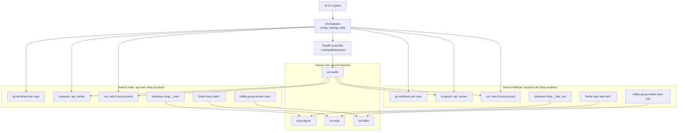

# Orchestration-Worktrees

Run a full, isolated copy of your dev stack for every git branch, side by side on one machine,
each on its own HTTPS subdomain.

```bash
wt up feat/cart     # git worktree + containers + route + TLS, then a health check
wt up main          # a second copy, running next to the first
wt ls               # branches, URLs, health
wt down feat/cart   # remove everything wt created for that branch
```

After `wt up feat/cart`, `https://api.feat-cart.shop.localhost` serves that branch's API while
`https://api.main.shop.localhost` keeps serving `main`.

wt ships no services of its own: you describe your stack (any repos, any languages) in
`worktree.yaml`. See [docs/SPEC.md](docs/SPEC.md) for the full design and roadmap.

> **Status: v0.3.0.** Git worktrees, Docker Compose services, host processes (`run:`), Traefik
> routes and local TLS, a Postgres provider that gives every branch its own cloned databases,
> a user catalog (`uses:`), and a terminal UI (`wt tui`). A complete two-branch example is in
> [examples/shop](examples/shop/README.md), and a two-repo one in
> [examples/notes](examples/notes/README.md). Redis (`shared.redis`) and Kafka
> (`shared.kafka`) are the v0.4 providers, described below.

## Requirements

- Python 3.11+ and [uv](https://docs.astral.sh/uv/)
- git, Docker with Compose 2.24+
- [mkcert](https://github.com/FiloSottile/mkcert) for trusted certificates (optional; without it
  branches get a self-signed certificate). On Debian/Ubuntu:
  `sudo apt install -y mkcert libnss3-tools`
- macOS, Linux, or Windows through WSL2

## Install

```bash
uv tool install git+https://github.com/LauroPeres/Orchestration-Worktrees
wt doctor          # checks docker, git, ports, certificates, name resolution
wt doctor --fix    # installs the local CA, creates the docker network, starts Traefik
```

`wt doctor --fix` creates the Docker network `wt` and starts the `wt-traefik` container on
`127.0.0.1:80/443`. `mkcert -install` may ask for your sudo password.

Traefik reads its route and certificate files through Docker mounts. After a Docker Desktop
restart those mounts can show empty folders, and every route answers 404. `wt doctor` reports
this as `traefik mounts`. `wt doctor --fix` recreates the Traefik container, and `wt up` does the
same once when the route file it just wrote is not visible to Traefik.

## Quick start

In your repo:

```bash
wt init            # writes a starter worktree.yaml
$EDITOR worktree.yaml
wt up my-branch    # prints a SERVICE / URL / CHECK table
wt ls              # branches, URLs, health, databases (--no-probe skips HTTP checks, --paths shows folders)
wt logs my-branch api   # follows one service's logs, compose or run: (--no-follow, --tail N)
wt tui                  # terminal UI: worktrees, services view, up/stop/add/remove
wt add my-branch        # worktrees + reserved ports only, status "stopped"; nothing is started
wt stop my-branch       # stops containers and processes; worktrees, volumes, databases, ports stay
wt down my-branch       # --force also removes worktrees with uncommitted changes
wt remove my-branch     # down + deletes the git branch (asks first; --yes, --force)
```

Running `wt up` again for a branch that is already up changes nothing. `wt down main` keeps
your main checkout.

`wt ls` counts `UP` as running/total over every service of a branch (compose containers and live
`run:` processes, e.g. `2/2`). STATUS is live: when docker is reachable, it shows `up` when every
service is running and passes its health check, and `degraded` otherwise. With `--no-probe` only
the `UP` count decides. Piped or redirected output is never wrapped or cut; only a terminal gets
the fixed-width layout.

## `worktree.yaml`

```yaml
project: shop
domain: shop.localhost          # *.localhost resolves to 127.0.0.1 in browsers

repos:                          # each repo gets a git worktree per branch
  api: ../shop-api
  web: ../shop-web

services:
  api:
    repo: api
    compose: docker-compose.yml # compose file inside the repo
    port: 8000                  # port the container listens on
    subdomain: api              # https://api.<branch>.shop.localhost
    health: /healthz            # must answer 2xx/3xx (or 401/403) after `up`
    env:
      PUBLIC_URL: "{{ url }}"
      WEB_URL: "{{ services.web.url }}"
  db:
    repo: api
    compose: docker-compose.yml # no subdomain: not routed, only checked for "running"
```

| Field | Meaning |
|---|---|
| `compose` | Compose file relative to the repo root. Set exactly one of `compose` or `run`. |
| `run` | Command for a host process (see below). Templates allowed. |
| `compose_service` | Service name in the compose file, if it differs from the key. |
| `port` | Container port Traefik routes to (compose), or the host port of a `run:` service (a number, or `auto`, see [Ports](#ports)). Required when `subdomain` is set. |
| `subdomain` | `""` = branch root (`https://<branch>.<domain>`); unset = not routed. |
| `health` | Path probed through Traefik after `up` (default `/`). |
| `env` | Extra environment for the container. Values can use templates; a `$` in a value is literal. |

Template values, resolved per branch: `project`, `branch`, `slug` (`feat-cart`), `ident`
(`feat_cart`), `domain`, `branch_domain`, `port`, `url`, `host`, and
`services.<name>.url|host|port`.

## Host processes (`run:`)

A service with `run:` instead of `compose:` is a plain process on your machine, started in that
branch's worktree:

```yaml
  web:
    repo: web
    run: npm run dev -- --host 0.0.0.0 --port {{ port }}
    port: auto                  # a deterministic port per branch and service (see Ports)
    subdomain: ""               # https://<branch>.shop.localhost
```

- The command runs with `sh -c`, with your environment plus the rendered `env`. `{{ port }}` and
  `services.<name>.port` hold the resolved port.
- Every `{{ ... }}` value in `run:` is shell-quoted for you, so a branch name like `x;rm -rf ~`
  stays one literal argument. Do not add quotes around template values in `run:`.
- `port: auto` gets the port from the formula in [Ports](#ports). An explicit number is used as
  is, and `up` fails if something else holds it.
- Running `wt up` again keeps a live process as is. If its rendered command, port or `env`
  changed in `worktree.yaml`, `up` stops it and starts the new one.
- Output goes to `~/.wt/<project>/branches/<slug>/logs/<service>.log`; read it with
  `wt logs <branch> <service>`.
- Traefik reaches the process through `host.docker.internal`. **Bind to `0.0.0.0`** (not only
  `127.0.0.1`): on native Linux the name resolves to the Docker bridge gateway, so a process
  listening only on loopback is unreachable. Docker Desktop (macOS, WSL2) also works with
  `127.0.0.1`, but `0.0.0.0` is the portable choice.
- `down` stops the whole process group (SIGTERM, then SIGKILL after 10 s).

## Postgres per branch (`shared.postgres`)

```yaml
shared:
  postgres:
    databases: [shop]       # each one is cloned per branch
    strategy: template      # template | dump-restore
    verify: true            # compare tables and row counts after the clone
    base_branch: main       # whose databases are the clone source (default main)
```

wt runs one shared `wt-postgres` container (`postgres:17-alpine`, superuser `wt`, password
generated into `~/.wt/postgres/password`, published on `127.0.0.1:55432`). Branch `feat/cart`
gets the database `shop__feat_cart`.

- On `base_branch` the databases are created empty; your migrations and seed fill them. Any
  other branch is cloned from the base databases the first time, and an existing clone is never
  re-cloned. If the base database does not exist yet, the clone is created empty with a
  warning: run `wt up <base_branch>` first.
- `template` clones with `CREATE DATABASE ... TEMPLATE`: fast, but base connections are
  dropped for about a second. `dump-restore` uses `pg_dump | pg_restore` and does not block the
  base branch.
- `verify` compares the table list and row counts of source and clone. With `template` a
  mismatch fails `up`; with `dump-restore` count differences only warn.
- Use it in templates: `{{ postgres.url('shop') }}` is a connection URL and
  `{{ postgres.name('shop') }}` the database name. Compose services get the address on the
  shared `wt` network; host processes get `127.0.0.1:55432`. Every compose service listed in
  `services:` joins the `wt` network when Postgres is configured.
- `down` drops that branch's databases and never the `base_branch` ones. It starts the shared
  Postgres container first if it is stopped.
- wt never drops the `base_branch` databases. When you are done with a project, drop them by
  hand, one per database (named `<database>__<base_branch>`):

  ```bash
  docker exec wt-postgres dropdb -U wt --force shop__main
  ```

  To remove the shared server with every database in it:
  `docker rm -f wt-postgres && docker volume rm wt-postgres-data && rm -r ~/.wt/postgres`.
- A branch whose database names equal the base branch's (for example `Main` with the base
  `main`) is refused by `up` before anything is created. Rename the branch.
- Keycloak under `shared:` is validated but ignored until v0.5.

## Redis per branch (`shared.redis`)

```yaml
shared:
  redis:
    prefix: true            # default; false shares every key between branches
```

wt runs one shared `wt-redis` container (`redis:7-alpine`, data in the `wt-redis-data` volume,
published on `127.0.0.1:56379`). Branch `feat/cart` gets the key prefix `feat-cart:`.

- `{{ redis.url }}` is the connection URL and `{{ redis.prefix }}` the key prefix of the branch.
  Compose services get `redis://wt-redis:6379` on the shared `wt` network; host processes get
  `redis://127.0.0.1:56379`.
- Isolation is by key prefix. wt does not rename keys: your app must write every key that starts
  with `{{ redis.prefix }}`.
- `prefix: false` turns isolation off. Branches then share every key, and the Redis check
  reports a warning.
- `down` deletes only that branch's keys (every key under its prefix, found with SCAN and removed
  with UNLINK). Other prefixes, and the shared server, are not touched.
- Overrides: `WT_REDIS_PORT` (host port, default `56379`) and `WT_REDIS_IMAGE` (default
  `redis:7-alpine`).

## Kafka per branch (`shared.kafka`)

```yaml
shared:
  kafka:
    groups: [worker]        # consumer groups; each one is named per branch
    topic_prefix: true      # default false; prefixes topics with the branch slug
```

wt runs one shared `wt-kafka` container (single-node `apache/kafka`, data in the
`wt-kafka-data` volume, published on `127.0.0.1:59092`). Branch `feat/cart` gets the consumer
group `worker-feat-cart` and, with `topic_prefix: true`, the topic `feat-cart.items` for `items`.

- `{{ kafka.bootstrap }}` is the bootstrap address. Compose services get `wt-kafka:9092` on the
  shared `wt` network; host processes get `127.0.0.1:59092`.
- `{{ kafka.group('worker') }}` is the group name of a name listed in `groups`. Any other name
  is an error.
- `{{ kafka.topic('items') }}` is the topic name: `feat-cart.items` with `topic_prefix`, plain
  `items` without it.
- Isolation is by naming. Each branch's services must use the names the templates give them.
- Topics are created automatically when first used.
- `down` deletes that branch's consumer groups and its topics with the `feat-cart.` prefix. The
  match is exact, so `feat-cart-x.*` topics are kept. Other branches and the shared server are
  not touched. With `topic_prefix` off, `down` deletes only the groups.
- Overrides: `WT_KAFKA_PORT` (host port, default `59092`) and `WT_KAFKA_IMAGE` (default
  `apache/kafka:3.9.1`).

## User catalog (`uses:`)

If the same services serve several projects, describe them once in a catalog. By default it is
`~/.wt/catalog.yaml`; a `catalog:` key in `worktree.yaml` or `WT_CATALOG` points elsewhere.
Each service lists its `infra` (what it needs, merged into `shared`) and its `consumes` (other
services whose URL it reads).

```yaml
# worktree.yaml
project: notes
domain: notes.localhost
catalog: ./catalog.yaml
uses: [front, back]            # exactly these; back's remote: is used if it were not selected
```

- A worktree.yaml has either `services:` (as above) or `uses:`, not both.
- `uses:` is exactly what runs. `consumes` does not add services. Repos come from the catalog.
- `consumes: {back: API_URL}` sets `API_URL` to the back's branch URL and starts the back first,
  when `back` is selected.
- When `back` is not selected, `API_URL` is the back's `remote:` URL.
- Every catalog service that some service consumes must set `remote:` (an `http://` or
  `https://` URL), or the catalog is invalid.
- A worktree can change its selection with `configure` (`c` in the services view of `wt tui`).
  The selection is stored per branch and starts from `uses:`.
- `wt catalog` prints the catalog: service, repo, kind, infra, consumes and consumed by.
  `wt catalog --check` validates it.

The full format and rules are in [docs/SPEC.md §15](docs/SPEC.md#15-v03-implementation-notes)
and [§17](docs/SPEC.md#17-v03-services-view-per-worktree-selection-deterministic-ports).
A working example is in [examples/notes](examples/notes/README.md).

## Terminal UI (`wt tui`)

`wt tui` shows one compact table with one row per worktree of the current project. Columns:
`NAME` and `STATUS`. Below the table is the action line and a message line.

```
NAME          STATUS
feat/cart     up
main          stopped
enter: services  u: up  d: down  a: add  r: remove  q: quit
```

| Key | Action |
|---|---|
| arrows | select a worktree |
| `enter` | open the services view of the selected worktree |
| `u` | up the selected worktree |
| `d` | stop the selected worktree (services down, worktree kept; the key is labeled `down`) |
| `a` | add a worktree (asks for its name) |
| `r` | remove the selected worktree (asks to confirm; then `remove --force`) |
| `q` | quit |

The services view has one row per repo of the worktree: `NAME`, `STATUS`, `PORT` and `URL`.
It refreshes every 2 s.

| Key | Action |
|---|---|
| `c` | configure: a checklist of the catalog services (`<service> (<repo>)`) |
| `esc` | back to the table |
| `q` | quit |

In the checklist, space toggles a service, enter confirms and runs `configure`, and esc cancels.
`configure` needs a catalog project (`uses:`); a `services:` project shows a message instead.

Colors: the key letters of the action line are green, `PORT` values are purple, and `STATUS`
values `healthy` and `up` are green. Everything else is plain.

Actions run in the background, one at a time; errors show on the message line and the app stays
open. The table refreshes by itself.

A `worktree` command opens the same TUI from any folder. Inside a project it opens that project.
Outside a project it lists the worktrees of every project wt knows. The repos' own checkout (e.g. `main`) is not listed: only the worktrees wt created, by the name they were given.

## Ports

- Each worktree gets a global index: the smallest number not used by any worktree of any project.
  It is kept in `$WT_HOME/worktree-index.json`. `stop` keeps the index; `down` and `remove`
  free it.
- A host port is `10000 + worktree index × 100 + service index`. The service index is the
  position of the service in the catalog's `services:` (or in your `services:` list), so it does
  not change with the selection. More than 100 services is an error. Worktree indexes above 554
  are an error, because the port would pass 65535.
- The formula applies to `port: auto` on `run:` services and to compose services with `port:`.
  An explicit number on a `run:` service is used as is.
- Compose services are published on `127.0.0.1` only, as `127.0.0.1:<host port>:<container port>`.
- There is no probing. If a port is used by another worktree, or is not free on the host, `up`
  or `add` fails with a message such as `port 10101 for service 'back' (worktree index 1) is in
  use; free it`.

## How isolation works

- **Names are derived from (project, branch)**, so the same branch always gets the same
  resources and `down` never guesses. `feat/cart` becomes `feat-cart`.
- **One compose project per branch and repo** (`wt-shop-feat-cart-api`). wt adds an override
  file that replaces published host ports with `127.0.0.1` bindings (see [Ports](#ports)), removes
  fixed `container_name`s (they would collide between branches) and attaches routed services to
  a shared `wt` Docker network.
- **One shared Traefik** bound to `127.0.0.1`, with one route file per branch in
  `~/.wt/traefik/dynamic/`.
- **One mkcert certificate per branch** for `<branch>.<domain>` and `*.<branch>.<domain>`,
  made again by `up` when `domain` changes.
- **Worktrees** live in `~/.wt/<project>/worktrees/<branch>/<repo>`. A branch that is already
  checked out (for example `main` in your repo) is used where it is and never removed.
- **`down` keeps your work**: it refuses when a worktree has uncommitted or untracked files
  (unless `--force`) and never deletes branches or commits. It does remove the branch's
  containers and volumes. A folder at a worktree path that is not a git worktree is left in
  place with a warning.

Overview of two branches of [examples/shop](examples/shop/README.md) running side by side. Each
branch has its own worktrees, containers, database, Redis key prefix, Kafka consumer group and
subdomain; the shared servers are the same for both.



## Settings

| Variable | Default | Purpose |
|---|---|---|
| `WT_CONFIG` | nearest `worktree.yaml` | config path (same as `--config`) |
| `WT_HOME` | `~/.wt` | where wt keeps state, worktrees and Traefik files |
| `WT_HTTP_PORT` / `WT_HTTPS_PORT` | `80` / `443` | host ports for Traefik |
| `WT_TRAEFIK_IMAGE` | `traefik:v3.5` | Traefik image |
| `WT_POSTGRES_IMAGE` | `postgres:17-alpine` | Postgres image |
| `WT_POSTGRES_PORT` | `55432` | host port of the shared Postgres |
| `WT_REDIS_PORT` | `56379` | host port of the shared Redis |
| `WT_REDIS_IMAGE` | `redis:7-alpine` | image of the shared Redis |
| `WT_KAFKA_PORT` | `59092` | host port of the shared Kafka |
| `WT_KAFKA_IMAGE` | `apache/kafka:3.9.1` | image of the shared Kafka |
| `WT_INSTANCE` | `wt` | prefix of the shared Docker objects (isolates test runs) |

A port variable (`WT_HTTP_PORT`, `WT_HTTPS_PORT`, `WT_POSTGRES_PORT`, `WT_REDIS_PORT`,
`WT_KAFKA_PORT`) that is not a number from 1 to 65535 makes wt stop with an error that names
the variable.

## WSL2

Tested on WSL2 with Docker Desktop. Inside WSL, `*.localhost` resolves for curl and browsers
and HTTPS works with the mkcert CA. Docker Desktop's WSL integration must be turned on for
your distro, otherwise `docker` is not found (see Troubleshooting).

Host processes (`run:`) are reached through `host.docker.internal`, which Docker Desktop
resolves for the Traefik container; the process may listen on `0.0.0.0` or `127.0.0.1`. On
native Linux Docker Engine only `0.0.0.0` works.

Browsers on Windows reach the stack through Docker Desktop's ports on `127.0.0.1`, but they do
not trust the CA that mkcert creates inside Linux. To trust it:

1. Copy `$(mkcert -CAROOT)/rootCA.pem` to a Windows path, for example
   `C:\Users\Public\wt-rootCA.crt`.
2. Double-click it, choose Install Certificate, then Current User.
3. Place it in "Trusted Root Certification Authorities".
4. Restart the browser.

## Troubleshooting

- **`docker` says it "could not be found in this WSL 2 distro"**: turn on Docker Desktop's
  WSL integration for that distro (Settings, Resources, WSL integration).
- **Windows `curl.exe` fails with `CRYPT_E_NO_REVOCATION_CHECK` on mkcert certificates**: use
  `curl.exe --ssl-no-revoke`. Browsers are not affected.
- **`wt doctor` warns that the OS resolver does not resolve `*.<domain>`**: expected. Browsers
  and curl resolve `*.localhost` themselves.

## Development

```bash
uv sync
uv run pytest                # unit tests
uv run pytest -m docker      # integration tests against a real Docker daemon
uv run ruff check && uv run ruff format --check && uv run mypy
```

## Benchmarks

Measured on the author's machine with `examples/shop` (Postgres, Redis, Kafka, an API and a worker in
Docker, and a web page as a host process), using a throwaway `WT_HOME`, `WT_INSTANCE` and free
ports.

- Machine: AMD Ryzen 7 7435HS (16 threads), 15 GiB RAM,
  Linux 7.2.11-arch1-1 (native, not WSL2), Docker 29.9.2 on the host kernel.

| Step | Runs (s) | Median (s) |
|---|---|---|
| `wt up feat/cart`, cold | 32.32, 38.02, 38.21 | 38.02 |
| `wt up feat/cart`, warm | 11.97, 13.16, 14.09 | 13.16 |
| `wt down feat/cart` | 8.55, 6.83, 6.79 | 6.83 |
| `wt up feat/cart` with `main` already up | 12.37, 12.21, 12.30 | 12.30 |

Commands, run from the directory made by `examples/shop/bootstrap.sh <dir>`, each timed as one
wall-clock run of the `wt` process:

```bash
wt up feat/cart      # cold: no shared servers, no shop images built
wt down feat/cart
wt up feat/cart      # warm: shared servers and images present
wt down feat/cart    # timed in the first round
wt up main           # not timed
wt up feat/cart      # timed: adding a second branch while main is up
```

Cold means the Postgres, Redis, Kafka and Traefik containers did not exist and the shop images
were built from scratch. The base images (`postgres`, `redis`, `apache/kafka`, `traefik`) were
already pulled and the Postgres volume was kept between cold runs 2 and 3. `mkcert` was not on the
`PATH` for these runs, so the certificates were self-signed. One machine, native Linux,
warm Docker image cache: expect different numbers elsewhere, especially on a first pull.

## Roadmap

| Version | Scope |
|---|---|
| v0.1 ✔ | CLI skeleton, config, naming, git worktrees, docker compose runtime, Traefik routes + TLS, `up/down/ls/doctor` |
| v0.2 ✔ | Postgres provider (template clone + verify), host-process runtime, `examples/shop` (api + web) |
| v0.3 ✔ | Bug fixes (stale Traefik mounts, live `ls` status), `wt tui`, user catalog (`uses:`), `examples/notes` |
| v0.4 | Kafka + Redis providers ✔, worker in the example ✔, README architecture diagram ✔, benchmarks ✔ |
| v0.5 | Keycloak provider (SSO across branch subdomains) |
| later | shared dependency caches, plugin entry points, native Windows |

The full design is in [docs/SPEC.md](docs/SPEC.md).

## License

MIT
